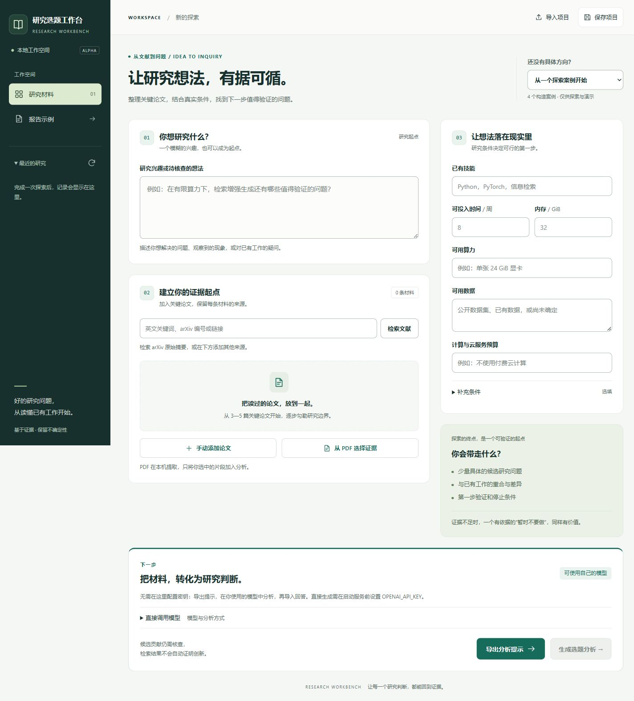

# Research Workbench

A local workspace for turning papers and research constraints into questions you can investigate.

[中文使用说明](使用说明.md) · [Detailed guide](docs/guide.md) · [Contributing](CONTRIBUTING.md)

Bring a research idea, a few papers, and your available time, data, and compute. Build a report that connects candidate questions to prior work and a first experiment—or explains why you should revise the idea or gather more evidence.

**Early alpha.** The interface and analysis instructions are currently in Chinese. The scientific usefulness of the generated suggestions has not been established in a user study.



*Actual local interface. The [report example](examples/demo.html) is manually authored and does not demonstrate model performance. [Mobile preview](docs/workbench-mobile.jpg).*

## Try it without an API key

Requires Python 3.11 or later. Download or clone this repository, open a terminal in its directory, and run:

```sh
python -m research_workbench serve
```

Open [the local workbench](http://127.0.0.1:8765). Click **报告示例** to inspect the manually authored demonstration. Stop the server with Ctrl+C.

For your own research:

1. Enter your question and research conditions.
2. Search arXiv for abstracts, add reading notes, or select passages from a local PDF.
3. Choose **导出分析提示**, use the prompt with your preferred model, and paste its JSON response into **导入模型回答**.

The prompt includes the required output format. Direct generation through the OpenAI API is optional; setup, usage, and costs are explained in the [guide](docs/guide.md).

To enable local PDF extraction, install the extra in the same Python environment and restart:

```sh
python -m pip install ".[pdf]"
python -m research_workbench serve
```

## What a report contains

| Question to investigate | Report content |
|---|---|
| What does the supplied material support? | Findings separated into source facts, calculations, and hypotheses |
| How does the idea differ from prior work? | Overlap and proposed differences with cited sources |
| Can I investigate this with my resources? | Time, compute, data, and budget considerations |
| What should I test first? | A baseline, variable, metric, and result that would weaken the hypothesis |
| What remains unknown? | Explicit limitations and next evidence to collect |

Reports contain at most three candidates. A result may recommend revising, stopping, or gathering evidence. The model's judgments still need your review.

## Evidence you can revisit

PDF passages retain the exact extracted text, file page number, character range, and SHA-256 fingerprints. Each run archives the original PDFs and extracted pages. Report references lead to the supplied passage and its original-file download.

Only selected material enters a model request. PDF extraction and run storage are local; arXiv searches send query terms to arXiv, and optional API analysis sends selected material to OpenAI. Run files can contain unpublished research. Project JSON exports include selected text, but PDF originals need to be transferred separately.

Reference IDs and saved-material integrity are checked. These checks do not prove that a quotation supports a claim, that a paper link matches an uploaded file, or that a proposed contribution is novel. PDF extraction is limited to 8 MB / 80 pages and has no OCR; verify formulas, tables, and complex layouts against the original.

## Compare workflows

The CLI supports a single-call baseline and a draft-then-review workflow. You can freeze case-specific criteria, prepare anonymous A/B reports, and record human judgments with supporting locations. See the [evaluation workflow](docs/guide.md) and [review instructions](docs/评审操作说明.md).

The four supplied cases are public development examples, not held-out tests. There is currently no evidence that two calls outperform one, or that the tool improves research outcomes.

## Help test real usefulness

Useful feedback identifies a concrete unsupported claim, missed prior work, infeasible experiment, or research decision that changed after using the report. Use the research-feedback issue template with material you can share publicly.

Contributions to reproducible bug fixes, research cases, literature coverage, and language support are welcome. Read [CONTRIBUTING.md](CONTRIBUTING.md) before adding a case or running comparisons.

```sh
python -m pip install ".[pdf]"
python -m unittest discover -s tests -v
```

Tests use synthetic PDFs, mocked model responses, and synthetic review judgments. They check software behavior, not research quality. The repository includes a GitHub Actions workflow; hosted results are available only after a repository run.

Licensed under [MIT](LICENSE).
